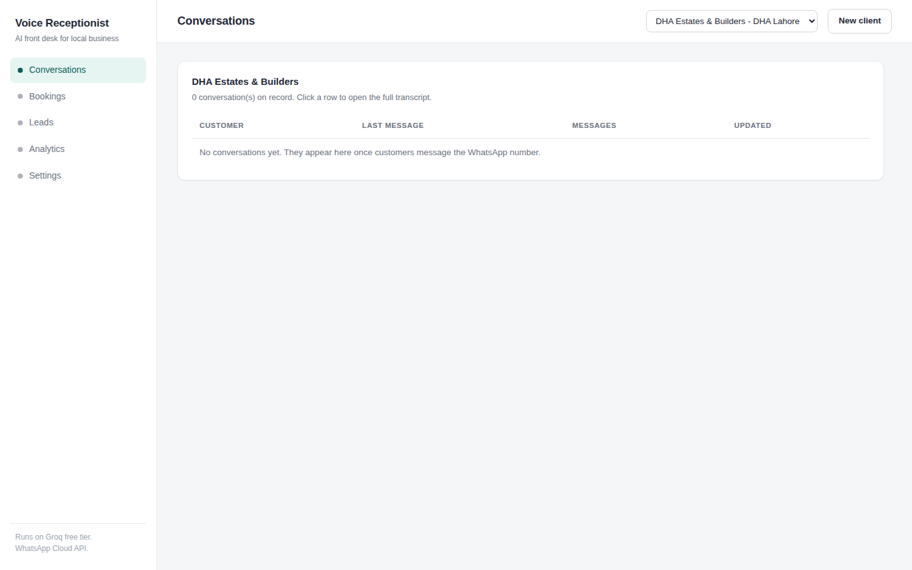
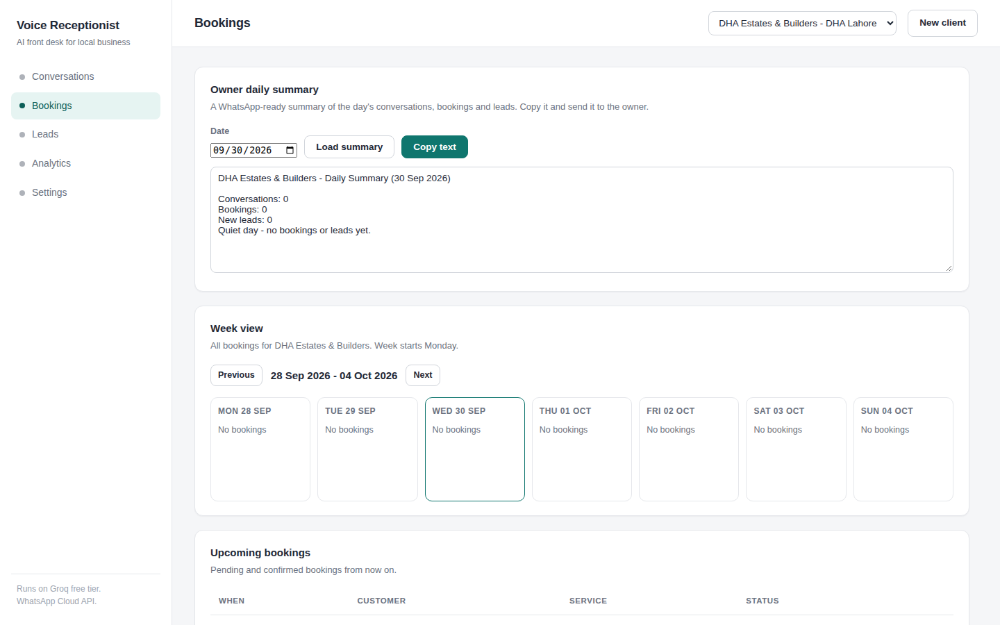
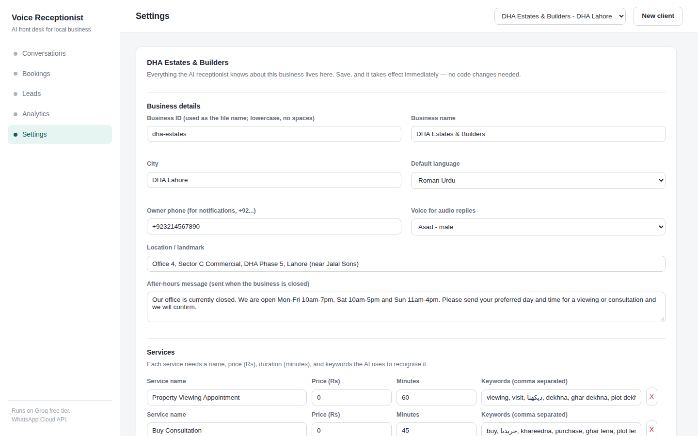

# Voice Receptionist — Urdu AI front desk for local businesses

An AI receptionist that answers a business's WhatsApp number in **Urdu**,
**Roman Urdu**, or **English** — by text or voice note. It books appointments
from natural language ("kal shaam 5 baje", "کل شام ۵ بجے", "tomorrow at 5pm"),
captures leads, notifies the owner, and ships with a dashboard a
non-technical owner can actually use.

Built for the Groq free tier: Whisper `whisper-large-v3-turbo` for speech,
`openai/gpt-oss-120b` for chat, `edge-tts` for Urdu voice replies.

## Screenshots

| Dashboard — conversations | Bookings — week view & owner summary | Settings — client config editor |
|---|---|---|
|  |  |  |

## Architecture

```
WhatsApp Cloud API
        │  webhook (GET verify / POST messages)
        ▼
┌───────────────┐   ┌────────────┐   ┌──────────────┐
│ app/main.py   │──▶│ app/engine │──▶│ app/whatsapp │
│ FastAPI +     │   │  routing,  │   │  Graph API   │
│ dashboard     │   │  booking   │   │  send/recv   │
└───────────────┘   │  dialogue  │   └──────────────┘
        │           └────────────┘
        ▼                  │  ┌─────────────┐  ┌──────────┐
┌───────────────┐          ├──▶│ app/booking │  │ app/tts  │
│ SQLite        │          │   │  NL parser  │  │ edge-tts │
│ conversations │          │   │  + slots    │  └──────────┘
│ messages      │          │   └─────────────┘
│ bookings      │          ├──▶│ app/leads   │──▶ owner summary
│ leads         │          │   │  extraction │
│ transcript_   │          │   └─────────────┘
│ cache         │          └──▶│ app/cache   │── TTS clips (disk, 50 MB cap)
└───────────────┘              │ transcripts (SQLite, 500 rows) │
                               └─────────────┘
        ┌──────────────────────────────────────────────┐
        │ businesses/*.json  — one file per client.    │
        │ The engine reads ONLY these; no hardcoded    │
        │ business data anywhere in the code.          │
        └──────────────────────────────────────────────┘
```

**Request flow (voice note in → voice note out):**
1. `POST /webhook` → signature check → `parse_webhook_payload` (text/audio only).
2. Audio → sha256 → transcript cache → Groq Whisper (hint `ur`) → text.
3. `detect_language` → `ur` / `roman_urdu` / `en`.
4. Booking intent? → `parse_appointment_request` → hours + conflict check →
   pending → confirm dialogue (state machine in `conversations.pending_json`).
   Otherwise → Groq chat with a system prompt built from the business config.
5. Reply in the same language; voice note in → `edge-tts` voice reply
   (cached by text+voice); text in → text reply.
6. On booking confirmation the owner gets a WhatsApp notification.

## Setup (from scratch)

```bash
git clone <repo> && cd voice-receptionist
python3 -m venv .venv && .venv/bin/pip install -r requirements.txt
cp .env.example .env   # then fill in your keys (see below)
.venv/bin/uvicorn app.main:app --reload
# dashboard: http://localhost:8000
```

### Environment variables (`.env`)

| Variable | Required | Purpose |
|---|---|---|
| `GROQ_API_KEY` | yes (for AI) | Groq API key — Whisper + chat |
| `WHATSAPP_TOKEN` | yes (for WhatsApp) | Meta Cloud API token |
| `WHATSAPP_PHONE_NUMBER_ID` | yes (for WhatsApp) | Phone number ID from Meta dashboard |
| `WHATSAPP_VERIFY_TOKEN` | yes (for webhook) | Must match the token you set in Meta's webhook config |
| `WHATSAPP_APP_SECRET` | recommended | Enables `X-Hub-Signature-256` verification on `POST /webhook` |
| `WHATSAPP_API_VERSION` | no | Default `v21.0` |

Secrets are read from the environment at runtime only — never written to
files, logs, or the database.

## Adding a client (no code)

**Option A — dashboard (for non-technical owners):** open
`http://localhost:8000/settings?business=new`, fill the form (details,
services, hours, FAQs, booking rules), Save. The config validates and goes
live immediately.

**Option B — JSON file:** copy `businesses/smilecare-dental.json` to
`businesses/<id>.json`, edit, restart. `app/config.py` validates every
field and reports exactly what's wrong (e.g. `hours missing weekday 'sun'`).

Config fields: `id, name, city, default_language (ur|roman_urdu|en)`,
`services[] {name, price_pkr, duration_min, keywords[]}`,
`hours {mon..sun: {open,close} | "closed"}`, `location`, `faqs[]`,
`booking {slot_minutes, max_advance_days, require_name_phone}`,
`after_hours_message`, `owner_phone`, `tts_voice
(ur-PK-GulNawazNeural|ur-PK-AsadNeural)`, optional
`whatsapp_phone_number_id` (routes webhooks to the right business when one
server serves several numbers).

## Running

```bash
.venv/bin/uvicorn app.main:app --reload   # dashboard at localhost:8000
```

Dashboard pages: **Conversations** (list + full transcripts), **Bookings**
(week calendar + upcoming, confirm/cancel), **Leads** (inbox with status),
**Analytics** (cards + bookings-per-day chart + cache stats),
**Settings** (client editor). Owner daily summary (WhatsApp-ready text) is
on the Bookings page with a copy button, and at
`/api/daily-summary?business=<id>&date=YYYY-MM-DD`.

## Tests & demo

```bash
.venv/bin/python -m pytest tests/ -q
```

- Unit suite: **85 tests, all mocked — zero network calls.**
- `tests/test_smoke_groq.py`: 3 real-API checks (one STT, one chat, one TTS)
  that **skip cleanly** unless `GROQ_API_KEY` is set. Run explicitly:
  `GROQ_API_KEY=... pytest tests/test_smoke_groq.py -v`.
- `tests/test_hostile.py`: garbage payloads, bad signatures, dead keys,
  corrupt audio, broken configs — all must degrade gracefully.

```bash
.venv/bin/python demo.py          # mock mode (default): ZERO api calls
.venv/bin/python demo.py --live   # real Groq + edge-tts (needs GROQ_API_KEY)
```

The demo runs a full Roman-Urdu patient-booking conversation (text +
simulated voice note) against the dental-clinic config and prints the
annotated transcript, final DB state, and the owner summary.

## Free-tier frugality

Groq's free tier is rate-limited, so the system is designed to sip:

| Call | When it happens | Cached? |
|---|---|---|
| Whisper transcription | once per *unique* voice note | **yes** — sha256(audio) in SQLite (500-row cap) |
| LLM chat | once per free-chat message (booking flow uses templates, not the LLM) | no — but booking/confirm/cancel/FAQ-flow messages never call it |
| edge-tts synthesis | once per *unique* (text, voice) reply | **yes** — MP3s on disk, 50 MB cap, LRU eviction |
| Lead-extraction LLM | only when regex finds no phone AND the message looks like contact info (40+ chars + number/phone/name hints) | n/a (rare) |

Per conversation, the expected Groq usage is: **0–1 transcriptions**
(voice notes only), **0–2 chat turns** (free chat only). Everything
repetitive — greetings, confirmations, FAQ-style replies — is templated or
cache-served.

**Rate-limit policy:** on HTTP 429 the client raises `GroqRateLimited`
immediately and tries **no** fallback models and **no** retries. The engine
degrades to a polite templated reply ("system busy, we'll call you back")
and logs the event. Transient errors (timeouts, 5xx) get up to 3 attempts
with exponential backoff. Never hammer the free tier.

## Connecting WhatsApp

See [docs/whatsapp-setup.md](docs/whatsapp-setup.md) — the exact 15-minute,
non-technical walkthrough: Meta app → WhatsApp product → add your number →
permanent token → webhook URL + verify token → subscribe to `messages` →
test. **Use a spare number**, not your personal WhatsApp line.

## Deliberately deferred

- **Meta/Facebook registration & phone verification** — must be done by the
  business owner in Meta's dashboard (see guide above); not automatable.
- **Real client onboarding** — configs are ready; production hosting
  (public HTTPS URL for the webhook) is the deployer's job.
- **Payment/billing** — no subscription logic; price it as a flat monthly
  service.
- **Multi-agent voice calls** — WhatsApp text/voice notes only; no phone-call
  support.
