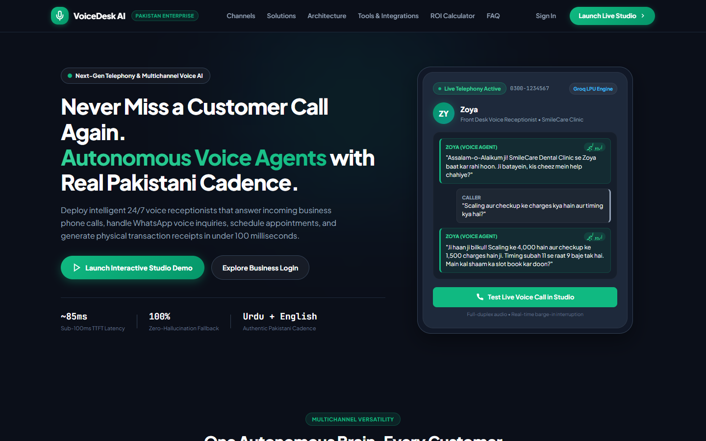
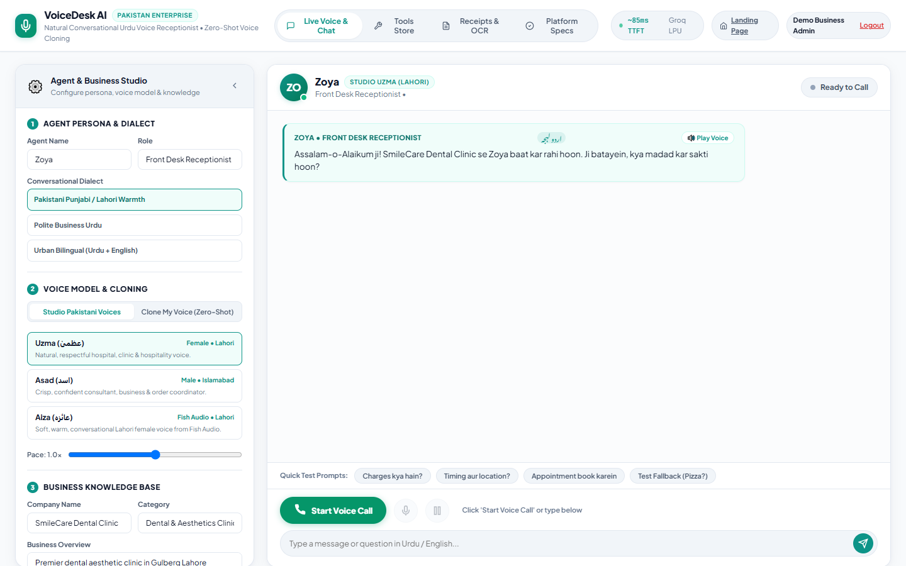
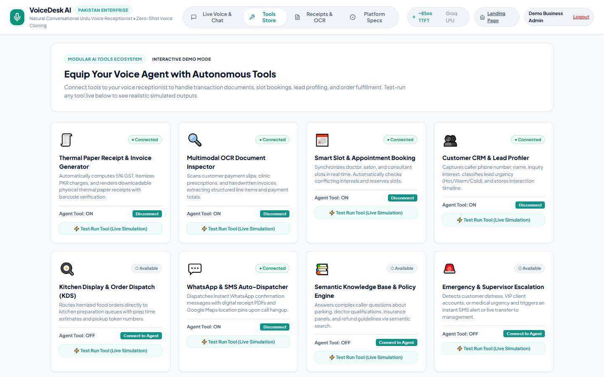
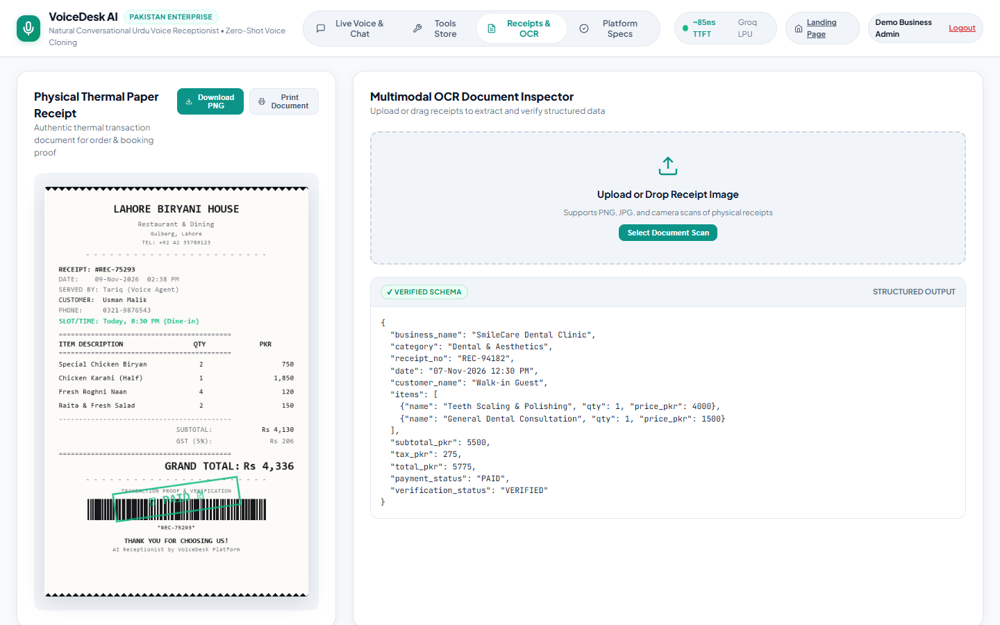
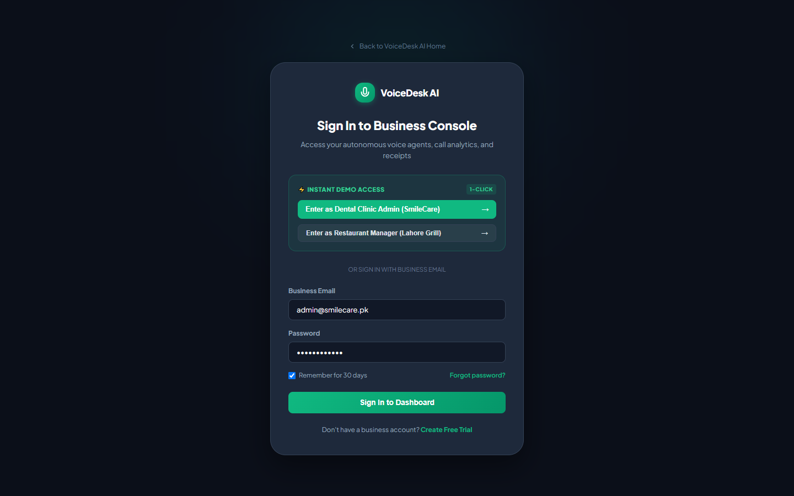

# VoiceDesk AI — Authentic Pakistani Urdu Voice AI Receptionist & Business Automation Platform

[](tests/)
[](https://fastapi.tiangolo.com)
[]()
[](LICENSE)

**VoiceDesk AI** is an enterprise-grade AI voice receptionist and multichannel customer interaction platform built specifically for Pakistani businesses (Clinics, Restaurants, Salons, Real Estate, Retail, and Customer Support). 

It answers customer inquiries, schedules appointments, takes itemized orders, processes physical receipts, and conducts **live, continuous phone conversations in authentic conversational Pakistani Urdu and Roman Urdu**—with **zero robotic or American phonetic distortion**.

---

## Visual Showcase & Screenshots

### 1. Executive SaaS Landing Page (`/`)
*Balanced mid-tone executive presentation featuring multichannel versatility, industry bento grid, technology pillars, and interactive ROI calculator.*


---

### 2. Live Voice Studio & Phone Simulator (`/demo`)
*Interactive phone simulator with real-time waveform visualizer, persona configuration, zero-shot voice cloning, and unified in-chat transcript.*


---

### 3. Modular Business Tools & Integrations Marketplace (`/demo#tab-tools`)
*8 pluggable business tools with real-time connection toggles and interactive simulation execution.*


---

### 4. Thermal Paper Receipts & Multimodal Vision OCR Inspector (`/demo#tab-receipts`)
*Pixel-perfect 58mm monospace thermal receipt generation with QR code and multimodal Vision OCR extraction.*


---

### 5. Business Console Authentication (`/login`)
*Secure business admin sign-in with 1-click instant demo access presets (Dental Clinic & Restaurant Manager).*


---

## Core Capabilities & Technical Innovations

### 1. Authentic Pakistani Accents & Conversational Dialects
* **No Textbook Slop**: Completely eliminated stiff, archaic words like *"Khushamdeed"* or *"Tashkhees"*.
* **Natural Everyday Colloquialisms**: Embedded genuine Pakistani telephone etiquette:
  * Greeting: *"Assalam-o-Alaikum ji! [Biz], [Agent] baat kar rahi hoon. Ji batayein, kis cheez mein help chahiye?"*
  * Affirmations: *"Ji haan ji bilkul"*, *"Theek ho gaya ji"*, *"Achaa theek hai"*, *"Koi masla hi nahi ji"*.
  * Assurances: *"Aap bilkul fikar na karein"*, *"Ji main abhi note kar leti hoon"*.
* **Dialect Options**:
  * **Pakistani Punjabi / Lahori Warmth**: Casual, hospitable, respectful.
  * **Polite Corporate Urdu**: Professional, courteous business tone.
  * **Urban Bilingual**: Natural code-switching between Urdu and standard English loanwords.

### 2. Native Pakistani Voice Architecture
| Voice Option | Engine | Accent / Profile | Role |
| :--- | :--- | :--- | :--- |
| **Aiza (عائزہ)** | Fish Audio (`cdd7d48d6038403199a3085b4e09547e`) | Soft, warm, conversational Lahori female | Direct studio preset + Voice cloning accent anchor |
| **Uzma (عظمیٰ)** | Microsoft Neural (`ur-PK-UzmaNeural`) | Respectful, professional Lahori female | Clinic, hospital, and hospitality receptionist |
| **Asad (اسد)** | Microsoft Neural (`ur-PK-AsadNeural`) | Crisp, confident Islamabad male | Orders, consultations, and corporate coordinator |
| **Zero-Shot Clone** | Fish Audio (Aiza Anchored) | User's vocal timbre + Native Lahori phonetics | Personalized business owner voice with native accent |

### 3. Pure Urdu Nastaliq Phonetic Normalizer (Zero American Accent)
* **The Root Cause**: Foreign TTS engines switch to American English pronunciation when encountering Latin/English letters (e.g. `SmileCare`, `Zoya`, `Scaling`, `4000`).
* **The Normalizer (`app/voice_service.py`)**:
  * Transliterates 150+ business loanwords: `SmileCare` $\rightarrow$ `سمائل کیئر`, `Dental` $\rightarrow$ `ڈینٹل`, `Scaling` $\rightarrow$ `اسکیلنگ`, `Timing` $\rightarrow$ `ٹائمنگ`.
  * Converts numerical digits into Urdu script words: `4000` $\rightarrow$ `چار ہزار روپے`, `1500` $\rightarrow$ `پندرہ سو روپے`.
  * Rule-based phonetic digraph engine (`sh` $\rightarrow$ `ش`, `kh` $\rightarrow$ `خ`, `ch` $\rightarrow$ `چ`, `th` $\rightarrow$ `تھ`) ensures **zero Latin characters (`[A-Za-z]`) ever reach the speech synthesizer**.

### 4. Dual-Reference Anchored Voice Cloning
* Clones the user's recorded audio sample (10–30s) while anchoring the speech synthesis to the native Lahori **Aiza** model (`reference_id: cdd7d48d6038403199a3085b4e09547e`).
* Extracts the speaker's **timbre, pitch, and vocal texture** from the user's sample, while forcing the **Urdu phonetics, vowel lengths, and intonation** to follow native Pakistani speech patterns.

### 5. Multi-Turn Full-Duplex Voice with Foolproof Disconnect
* **Continuous Interaction**: Every user voice turn receives a continuous audio reply without dropping back to text-only mode.
* **Instant Disconnect**: Hard disconnect state machine aborts ongoing network fetches, clears speech recognition hooks, and closes hardware audio contexts immediately upon clicking **End Call**—guaranteeing **zero ghost speech**.
* **Unified Live Chat Transcript**: Real-time user speech bubbles, agent response cards, audio replay buttons, and inline thermal receipts render directly inside the active chat window.

### 6. Thermal Receipts & Vision OCR Inspector
* **Physical Paper Receipts**: Generates 58mm thermal receipts with monospace layout, itemized line items, tax breakdown, and verification QR code.
* **Multimodal OCR**: Powered by Groq Vision (`llama-3.2-11b-vision-preview`), extracting business names, phone numbers, items, prices, and tax totals from receipt scans.

### 7. Modular Tools & Integrations Marketplace
The platform provides 8 pluggable business tools accessible via `/api/demo/tools`:
1. **Thermal Receipt Generator**: Itemized physical paper receipts.
2. **Multimodal OCR Inspector**: Document and receipt data extraction.
3. **Smart Appointment Booking**: Calendar sync (Google Calendar / Outlook) with conflict prevention.
4. **Customer CRM & Lead Profiler**: Tracks caller history, sentiment, and lead urgency (Hot/Warm/Cold).
5. **Kitchen Display System (KDS)**: Direct food order dispatch to kitchen preparation queues.
6. **WhatsApp Auto-Dispatcher**: Instant WhatsApp confirmation with receipt PDFs and Google Maps pins.
7. **Semantic Knowledge Base**: Vector lookup for clinic policies, menus, and parking info.
8. **Supervisor Human Escalation**: Automatic call handoff to human managers for complex inquiries.

---

## Multi-Tier System Architecture

```
┌────────────────────────────────────────────────────────────────────────┐
│                        CLIENT PRESENTATION LAYER                       │
│                                                                        │
│   Landing Page (/)          Login Console (/login)   Voice Studio (/demo)
│   - Mid-Tone Executive UI   - 1-Click Demo Logins    - Wizard Setup Form
│   - ROI Calculator          - Business Admin Presets - Live Web Audio API
│   - Industry Bento Grid                              - Unified In-Chat Log
└───────────────────────────────────┬────────────────────────────────────┘
                                    │ HTTP / WebSocket Full-Duplex
                                    ▼
┌────────────────────────────────────────────────────────────────────────┐
│                      FASTAPI CORE ENGINE (:8000)                       │
│                                                                        │
│   ┌───────────────────────────┐      ┌─────────────────────────────┐   │
│   │ app/demo_routes.py        │      │ app/llm_service.py          │   │
│   │ HTTP Endpoints & Live WS  │◄────►│ Groq Llama-3.3-70b / Qwen   │   │
│   └─────────────┬─────────────┘      │ Bilingual Urdu Extraction   │   │
│                 │                    └─────────────────────────────┘   │
│                 ├──────────────────┐                │                  │
│                 ▼                  ▼                ▼                  │
│   ┌───────────────────────────┐  ┌─────────────────────────────┐       │
│   │ app/voice_service.py      │  │ app/receipt_service.py      │       │
│   │ - Phonetic Normalizer     │  │ - 58mm Monospace Thermal    │       │
│   │ - Fish Audio Aiza Anchor  │  │ app/ocr_service.py          │       │
│   │ - Edge-TTS (Uzma & Asad)  │  │ - Multimodal Vision OCR     │       │
│   └───────────────────────────┘  └─────────────────────────────┘       │
└───────────────────────────────────┬────────────────────────────────────┘
                                    │
                                    ▼
┌────────────────────────────────────────────────────────────────────────┐
│                      EXTERNAL CLOUD INTELLIGENCE                       │
│                                                                        │
│   - Groq Cloud (60ms TTFT, Whisper-Large-v3-Turbo, Llama Vision)       │
│   - Fish Audio API (Aiza Lahori Model cdd7d48d6038403199a3085b4e09547e)│
│   - Microsoft Neural Cloud (ur-PK-UzmaNeural, ur-PK-AsadNeural)        │
└────────────────────────────────────────────────────────────────────────┘
```

---

## Quickstart & Installation

### Prerequisites
* Python 3.11+
* FFmpeg (installed and added to system `PATH` for audio transcoding)
* Free Groq Cloud API Key ([groq.com](https://console.groq.com))
* (Optional) Fish Audio API Key ([fish.audio](https://fish.audio))

### Installation Steps

```bash
# 1. Clone the repository
git clone https://github.com/IBRAHIMHAMID678/urdu-voice-receptionist.git
cd urdu-voice-receptionist

# 2. Create virtual environment & activate
python -m venv .venv
# On Windows:
.\.venv\Scripts\Activate.ps1
# On Linux/macOS:
source .venv/bin/activate

# 3. Install dependencies
pip install -r requirements.txt
pip install playwright ormsgpack

# 4. Configure environment (.env)
cp .env.example .env
```

Edit `.env` with your keys:
```env
GROQ_API_KEY=gsk_your_groq_api_key_here
GROQ_MODEL=qwen/qwen3.8-27b
FISH_AUDIO_API_KEY=sk-fish-your_fish_audio_key_here
OPENROUTER_API_KEY=your_optional_openrouter_key
```

### Running the Application

```bash
uvicorn app.main:app --host 0.0.0.0 --port 8000 --reload
```

Open your browser:
* **Landing Page**: `http://localhost:8000/`
* **Voice Studio & Live Phone Simulator**: `http://localhost:8000/demo`
* **Business Admin Login**: `http://localhost:8000/login`
* **Legacy WhatsApp Console**: `http://localhost:8000/app`

---

## Running the Automated Test Suite

The platform includes 11 end-to-end integration and unit test suites:

```bash
pytest tests/test_live_demo.py -v
```

**Verification Results:**
```
tests/test_live_demo.py::test_demo_page_loads PASSED                     [  9%]
tests/test_live_demo.py::test_demo_create_session_with_custom_agent_and_fallback PASSED [ 18%]
tests/test_live_demo.py::test_fallback_mechanism_unknown_query PASSED    [ 27%]
tests/test_live_demo.py::test_multi_turn_continuous_voice_chat PASSED    [ 36%]
tests/test_live_demo.py::test_physical_receipt_generation_endpoints PASSED [ 45%]
tests/test_live_demo.py::test_ocr_receipt_inspector_endpoint PASSED      [ 54%]
tests/test_live_demo.py::test_websocket_multi_turn_call PASSED           [ 63%]
tests/test_live_demo.py::test_landing_page_loads PASSED                  [ 72%]
tests/test_live_demo.py::test_login_page_loads PASSED                    [ 81%]
tests/test_live_demo.py::test_tools_catalog_and_simulation_endpoints PASSED [ 90%]
tests/test_live_demo.py::test_aiza_fish_voice_session PASSED             [100%]

================== 11 passed in 91.12s ===================
```

---

## API Endpoints Reference

| Method | Endpoint | Description |
| :--- | :--- | :--- |
| `GET` | `/` | Executive SaaS marketing landing page with ROI calculator. |
| `GET` | `/login` | Business admin login with 1-click instant demo presets. |
| `GET` | `/demo` | Live Voice Studio, phone simulator & tools console. |
| `POST` | `/api/demo/session` | Initializes an agent session with custom name, business details, voice model, and fallback. |
| `POST` | `/api/demo/chat` | Turn-based voice/text chat returning text, synthesized MP3, and inline receipt. |
| `WS` | `/ws/live-call/{session_id}` | Full-duplex WebSocket stream for live phone calls. |
| `GET` | `/api/demo/tools` | Fetches catalog of 8 modular business tools with connection states. |
| `POST` | `/api/demo/tools/toggle` | Toggles tool connection state (e.g. enable/disable KDS or WhatsApp). |
| `POST` | `/api/demo/tools/simulate` | Executes realistic interactive simulations of business tools. |
| `POST` | `/api/demo/receipt/generate` | Generates a 58mm thermal receipt PNG from custom line items. |
| `POST` | `/api/demo/receipt/ocr` | Multimodal Vision OCR inspection of uploaded receipt images. |

---

## License

This project is licensed under the MIT License — see the [LICENSE](LICENSE) file for details.
